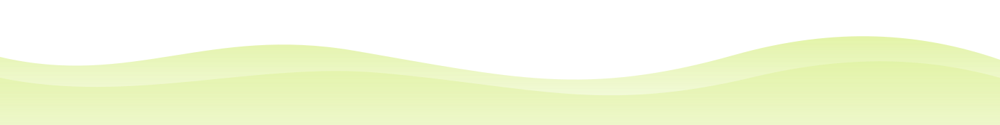

  

   
  
Frontend &amp; AI Developer

<h3 align="center">ABOUT ME</h3>

Computer Science student at Guangdong University of Technology, passionate about frontend development and AI applications.

<h3 align="center">TECH STACK</h3>
<table align="center">
  <tr>
    <td align="center" width="50%">
      <b>FRONTEND</b>  
      
      
      
       
      
      
    </td>
    <td align="center" width="50%">
      <b>AI &amp; BACKEND</b>  
      
      
      
       
      
      
    </td>
  </tr>
</table>

<h3 align="center">OPEN SOURCE / PROJECTS</h3>
<table align="center">
  <tr>
    <td align="center" width="50%">
      <strong><a href="https://github.com/we-used-to-be/Guanmo-open">Guanmo</a></strong>  
      AI-powered Markdown editor  
      Creator / Maintainer  
      
    </td>
    <td align="center" width="50%">
      <strong><a href="https://github.com/we-used-to-be/DeskHide">DeskHide</a></strong>  
      Lightweight Windows desktop utility  
      Creator
    </td>
  </tr>
</table>

<h3 align="center">MY CONTRIBUTION</h3>

  <picture>
    <source media="(prefers-color-scheme: dark)" srcset="https://raw.githubusercontent.com/we-used-to-be/we-used-to-be/output/github-snake-dark.svg" />
    <source media="(prefers-color-scheme: light)" srcset="https://raw.githubusercontent.com/we-used-to-be/we-used-to-be/output/github-snake.svg" />
    
  </picture>

  <picture>
    <source media="(prefers-color-scheme: dark)" srcset="./assets/wave-dark.svg" />
    <source media="(prefers-color-scheme: light)" srcset="./assets/wave.svg" />
    
  </picture>

